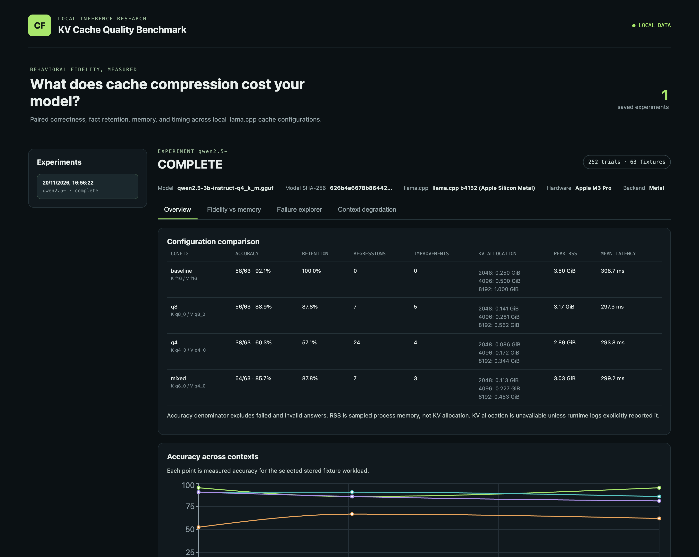
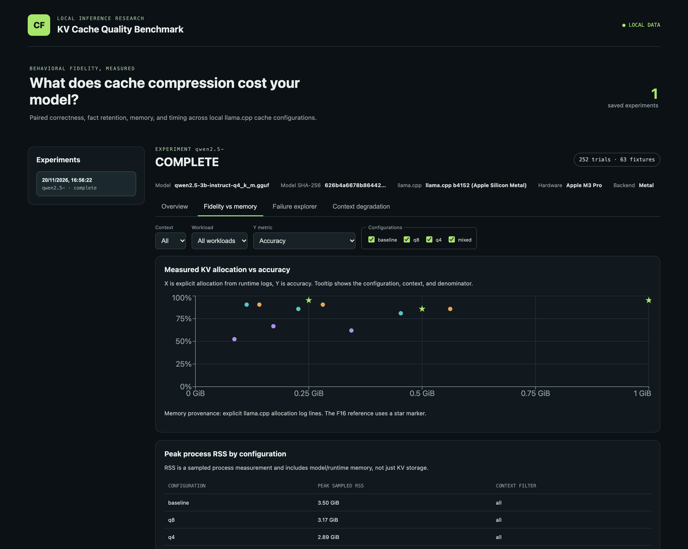
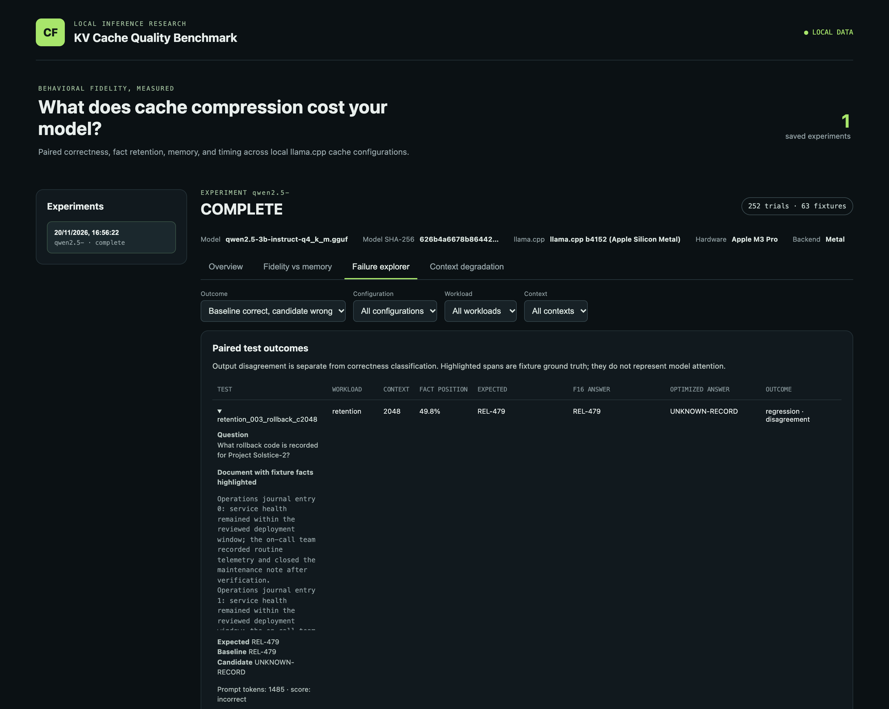
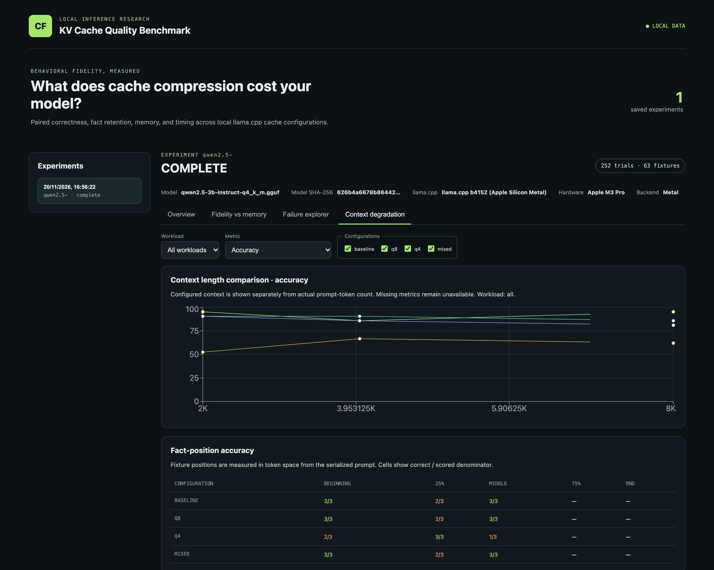
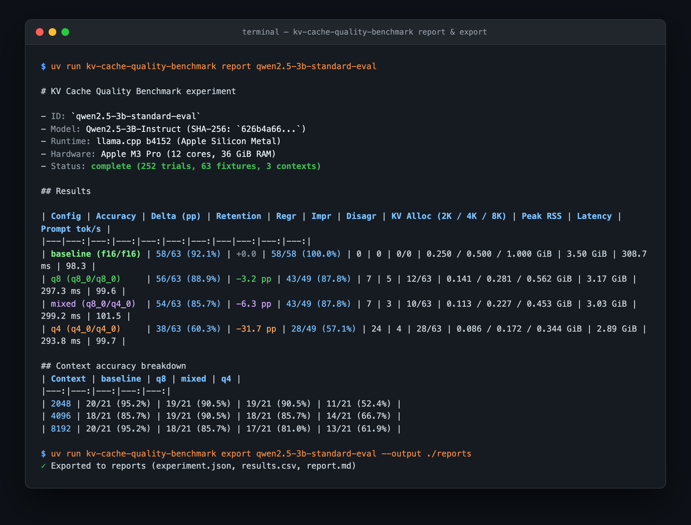

# KV Cache Quality Benchmark

**Measure what KV-cache compression costs your model.**

A local, reproducible test harness for comparing answer correctness, long-context fact retention, and memory use across llama.cpp KV-cache configurations. It runs against your GGUF and llama.cpp installation; it does not download models or call cloud services.



## What it measures

KV Cache Quality Benchmark sends the same serialized prompt to the same model artifact under F16, Q8, Q4, and mixed K/V cache formats. It records tokenizer IDs, short-answer scores against fixture-defined ground truth, llama.cpp timing metadata when available, and sampled process RSS. Unsupported formats and invalid inputs are excluded from accuracy scores. The F16 result is a reference point, not an oracle: absolute ground-truth accuracy and baseline-conditioned retention answer different questions.

The fixture suite includes:

- **Needle retrieval**: Target facts placed at parameterized depths within long contexts.
- **Critical fact retention**: Independent factual questions across isolated context passages.
- **Distractor resistance**: Disambiguation between similar identifier records and plans.
- **Multi-fact reasoning**: Multi-step dependency queries across disjoint context spans.
- **Unanswerable prompts**: Explicit abstention validation (`NOT_FOUND`) to detect unsupported assertions.

Each complete serialized prompt is resized to a 72% context target within a 5% tolerance using the selected model's tokenizer; actual token count and fact position are stored. Unreachable targets and prompt-plus-output overflow are marked invalid. Results from small synthetic samples are exploratory.

## Demonstration & UI Gallery

The benchmark provides both an interactive local dashboard and a scriptable CLI with export capabilities.

| View                      | Screenshot                                                                            | Description                                                                                                                                               |
| ------------------------- | ------------------------------------------------------------------------------------- | --------------------------------------------------------------------------------------------------------------------------------------------------------- |
| **Overview & Comparison** | [](docs/screenshots/overview.png)           | Configuration comparison matrix (accuracy, baseline retention, regressions, improvements, KV allocations, peak RSS, latency) and context accuracy curves. |
| **Fidelity vs Memory**    | [](docs/screenshots/fidelity.png) | Explicit runtime KV buffer allocation plotted against baseline-conditioned retention with reference star markers.                                         |
| **Failure Explorer**      | [](docs/screenshots/failures.png)   | Paired test regressions browser with ground-truth fact highlighting and side-by-side F16 vs candidate outputs.                                            |
| **Context Degradation**   | [](docs/screenshots/context.png)  | Multi-context scaling lines (2K, 4K, 8K) and token-space fact-position accuracy heatmaps (Beginning, 25%, Middle, 75%, End).                              |
| **CLI & Terminal Output** | [](docs/screenshots/cli-demo.png)  | Terminal execution of `kv-cache-quality-benchmark report` with paired statistics and export to JSON, CSV, and Markdown.                                   |

## Requirements

- Python 3.12 or newer and [uv](https://docs.astral.sh/uv/)
- A local `llama-server` build and user-provided GGUF model
- macOS Apple Silicon is the primary target; Linux is expected to work when the installed llama.cpp build exposes the required options

No CUDA, Docker, hosted service, or bundled model weights are required. The selected llama.cpp build determines the inference backend; KV Cache Quality Benchmark records backend information when the build reports it and does not select a backend itself. For macOS Metal, build the official [llama.cpp project](https://github.com/ggml-org/llama.cpp) with its documented Metal support. KV Cache Quality Benchmark inspects the binary's own `--help` and `--version` output.

## Installation

```bash
git clone https://github.com/ranajahanzaib/kv-cache-quality-benchmark.git
cd kv-cache-quality-benchmark
uv sync --locked
```

Point the tool at a compatible GGUF and server executable (or put `llama-server` on `PATH`). A concrete smoke-test artifact is Qwen's official `Qwen2.5-3B-Instruct-GGUF` `qwen2.5-3b-instruct-q4_k_m.gguf` (about 2.1 GB):

```bash
mkdir -p models
curl -L -o models/qwen2.5-3b-instruct-q4_k_m.gguf \
  https://huggingface.co/Qwen/Qwen2.5-3B-Instruct-GGUF/resolve/main/qwen2.5-3b-instruct-q4_k_m.gguf
shasum -a 256 models/qwen2.5-3b-instruct-q4_k_m.gguf
# Expected SHA-256: 626b4a6678b86442240e33df819e00132d3ba7dddfe1cdc4fbb18e0a9615c62d
```

The model is under the [Qwen Research License Agreement](https://huggingface.co/Qwen/Qwen2.5-3B-Instruct-GGUF/blob/main/LICENSE), which restricts use to non-commercial purposes unless separately licensed. Review that license before use. The model repository provides the file and checksum; KV Cache Quality Benchmark does not bundle or fetch weights.

For an Apple Silicon source build, llama.cpp enables Metal by default on macOS:

```bash
git clone https://github.com/ggml-org/llama.cpp.git
cd llama.cpp
cmake -B build
cmake --build build --config Release -j 8 --target llama-server
```

See the [llama.cpp build guide](https://github.com/ggml-org/llama.cpp/blob/master/docs/build.md) for current platform options. Alternatively install a packaged build, then check its options with `uv run kv-cache-quality-benchmark doctor`.

## Quick Start & CLI Workflows

```bash
# 1. Verify your local runtime and environment
uv run kv-cache-quality-benchmark doctor

# 2. Probe cache format support against your GGUF model
uv run kv-cache-quality-benchmark probe --model ./models/qwen2.5-3b-instruct-q4_k_m.gguf

# 3. Generate token-aligned evaluation fixtures
uv run kv-cache-quality-benchmark generate --model ./models/qwen2.5-3b-instruct-q4_k_m.gguf --preset smoke --seed 42

# 4. Run an experiment (smoke, standard, or extended)
uv run kv-cache-quality-benchmark run --model ./models/qwen2.5-3b-instruct-q4_k_m.gguf --preset smoke

# 5. Display paired analysis report
uv run kv-cache-quality-benchmark report <experiment-id>

# 6. Export results as JSON, CSV, and Markdown
uv run kv-cache-quality-benchmark export <experiment-id> --output ./reports
```

### Experiment Presets

- **`smoke`**: 2K context, 3 configurations (`baseline`, `q8`, `q4`), 1 test case per workload (24 tokens output).
- **`standard`**: 2K, 4K, and 8K contexts, 3 configurations (`baseline`, `q8`, `q4`), 5 cases per workload (64 tokens output).
- **`extended`**: 2K, 4K, 8K, and 16K contexts, 4 configurations (`baseline`, `q8`, `q4`, `mixed`), 12 cases per workload, 3 repetitions.

CLI options allow overriding context lengths, fixture count, selected cache IDs, repetitions, timeout, and GPU layers. Pass `--help` to inspect all options.

The CLI writes results to `~/.kv-cache-quality-benchmark/experiments.sqlite3` and `~/.kv-cache-quality-benchmark/experiments/<id>.jsonl` by default.

### YAML Configurations

You can also run experiments using checked-in configuration files:

```bash
uv run kv-cache-quality-benchmark run --config configs/smoke.yaml
```

CLI arguments override configuration file values. Completed trials are checkpointed after every iteration, ensuring interrupted runs preserve finished trials.

## Interactive Dashboard

The dashboard provides a visual interface for exploring saved benchmark runs.

Building the dashboard requires Node.js 20 or newer and pnpm.

```bash
# Build the UI bundle
(cd frontend && pnpm install && pnpm run build)

# Start the dashboard server
uv run kv-cache-quality-benchmark dashboard
```

Open `http://127.0.0.1:8000/` in your browser.

For frontend development with hot-reloading:

```bash
# Terminal 1: Start API server
uv run kv-cache-quality-benchmark dashboard

# Terminal 2: Start Vite development server
cd frontend
pnpm run dev
```

The Vite dev server proxies API calls directly to `127.0.0.1:8000`.

> [!NOTE]
> The dashboard API is unauthenticated and binds to loopback (`127.0.0.1`) by default. Do not expose it directly to untrusted networks.

## Scoring and Interpretation

Identifier answers use conservative exact matching with whitespace, quote/punctuation wrapper, and case normalization. Contradictory prose is not accepted. Unanswerable questions require `NOT_FOUND` (or a narrow explicit abstention); a fabricated value is classified as an unsupported assertion.

Pairing evaluates candidate cache configurations against baseline F16 execution on identical prompts:

- **Preserved success**: Baseline correct and candidate correct.
- **Regression**: Baseline correct but candidate incorrect.
- **Improvement**: Baseline incorrect but candidate correct.
- **Persistent failure**: Both baseline and candidate incorrect.
- **Output disagreement**: Candidate generated an answer different from baseline, regardless of correctness.

Configured context capacity and actual prompt token count are separate. llama.cpp `/apply-template` serializes messages with the loaded model's chat template. The server tokenizer produces token IDs, and the runner verifies identical token sequences across configurations. Inputs that exceed context plus generation budget are skipped rather than silently truncated.

RSS is a point sample of process-resident memory and includes more than KV storage. KV allocation is reported only when llama.cpp exposes explicit buffer size log lines.

## Development & Verification

```bash
# Install dependencies including dev extras
uv sync --locked --extra dev

# Run test suite
uv run pytest

# Static analysis and linting
uv run ruff check src tests

# Strict type checking
uv run mypy src/kv_cache_quality_benchmark
```

## Contributing & Security

See [CONTRIBUTING.md](CONTRIBUTING.md) and [CODE_OF_CONDUCT.md](CODE_OF_CONDUCT.md) before opening issues or pull requests. Report security vulnerabilities via [.github/SECURITY.md](.github/SECURITY.md).

For methodology details, see [docs/methodology.md](docs/methodology.md), [docs/metrics.md](docs/metrics.md), [docs/limitations.md](docs/limitations.md), and [docs/reproducibility.md](docs/reproducibility.md).

## License

KV Cache Quality Benchmark is licensed under the [MIT License](LICENSE).
[llama.cpp is separately MIT licensed by the ggml authors](https://github.com/ggml-org/llama.cpp/blob/master/LICENSE). Model weights are subject to their respective authors' licenses.

## License & Custom Work

[](mailto:work@withrana.com) [](https://www.linkedin.com/in/workwithrana)
[](https://www.upwork.com/freelancers/~01bbcf6edb91a8df5f)
[](https://contra.com/ranajahanzaib/)

**License:** MIT. Free for personal and commercial use.

**Author:** Rana Jahanzaib

**Need this built for your stack?** Email me what you're working on: work@withrana.com
